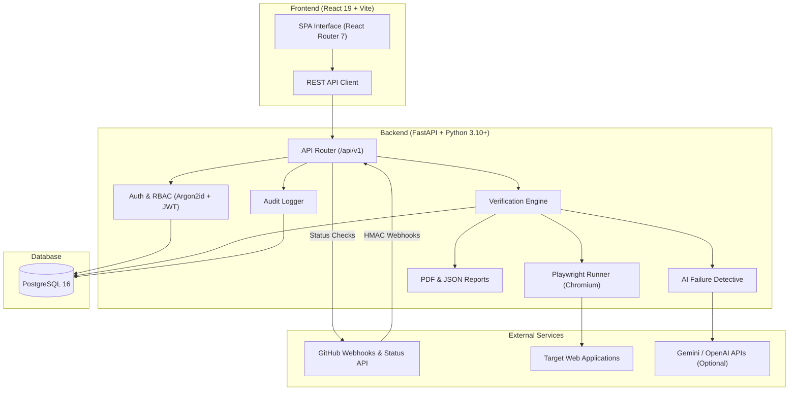

# VeriGate – Software Verification & QA Command-Center Platform

&nbsp;&nbsp;&nbsp;&nbsp;&nbsp;&nbsp;&nbsp;&nbsp;&nbsp;&nbsp;&nbsp;&nbsp;&nbsp;&nbsp;

> VeriGate is a software verification and test management platform coordinating manual QA, automated Playwright browser verification, AI failure diagnostics, and CI/CD pull request validation in a unified command center.

PR summary comments are disabled by default and can be enabled per project in GitHub settings. Set `FRONTEND_URL` to the public UI URL so comments link back to runs. The GitHub token needs classic `repo` scope (`public_repo` for public repositories), or fine-grained **Pull requests** and **Issues** read/write permissions.

---

## Live Deployments

* **Frontend (React / Vite)**: [https://verigate-frontend-j0ph.onrender.com](https://verigate-frontend-j0ph.onrender.com)
* **Backend API**: [https://verigate-ppkr.onrender.com](https://verigate-ppkr.onrender.com)
* **Swagger API Docs**: [https://verigate-ppkr.onrender.com/docs](https://verigate-ppkr.onrender.com/docs)
* **OpenAPI JSON**: [https://verigate-ppkr.onrender.com/openapi.json](https://verigate-ppkr.onrender.com/openapi.json)

---

## Key Features

* **Role-Based Access Control (RBAC)**: Argon2id password hashing and stateless JWT tokens. System roles (`admin`, `user`) and granular project roles (`owner`, `manager`, `qa_lead`, `tester`, `developer`, `viewer`).
* **Operational Dashboard**: Real-time project health scoring (0–100), pass/fail telemetry, recent run timelines, and 14-day trend charts.
* **Admin Module & CLI**: Global project monitoring, user activation/role promotion, system audit trails, and a CLI utility (`scripts/manage_admin.py`).
* **Test Case Management**: Hierarchical test organization across projects, suites, and test cases with priorities and manual or automated execution modes.
* **Automated Playwright Execution**: Configurable headless browser test actions (`goto`, `click`, `fill`, `expect_text`, `expect_title`) with automatic full-page failure screenshot capture.
* **AI Failure Detective**: Automated root-cause diagnosis for failed test results powered by Google Gemini, OpenAI, or a deterministic heuristic fallback engine.
* **GitHub PR Verification**: HMAC-SHA256 verified webhook receiver that triggers automated verification on pull requests and reports commit status checks back to GitHub.
* **Defect Tracking & PDF Reports**: Direct issue logging linked to failed test results, immutable audit logs, and exportable audit-ready PDF/JSON reports.

---

## System Architecture



---

## Quickstart & Installation

### Prerequisites
* Python 3.10+, Node.js 18+, PostgreSQL 15/16 (or Docker), Git

### 1. Database (Docker)
```bash
docker compose up -d
```

### 2. Backend Setup
```bash
cd Backend
python -m venv .venv

# Windows:
.\.venv\Scripts\Activate.ps1
# Linux/macOS: source .venv/bin/activate

pip install -r requirements.txt -r requirements-dev.txt
playwright install chromium
cp .env.example .env
alembic upgrade head

# Start backend server (http://localhost:8000)
uvicorn app.main:app --reload --port 8000
```

### 3. Frontend Setup
```bash
cd frontend
npm install
npm run dev
```
Access the application at `http://localhost:5173`.

---

## Automated Testing & Evidence Capture

Automated test cases define action sequences stored in `automation_steps`:

| Action | Parameters | Example | Purpose |
| :--- | :--- | :--- | :--- |
| `goto` | `value` (URL) | `{"action": "goto", "value": "https://example.com"}` | Navigates browser to URL |
| `click` | `selector` | `{"action": "click", "selector": "button#submit"}` | Clicks matched element |
| `fill` | `selector`, `value` | `{"action": "fill", "selector": "input#email", "value": "test@test.com"}` | Inputs text into field |
| `expect_text` | `value`, `selector` | `{"action": "expect_text", "selector": "h1", "value": "Dashboard"}` | Asserts text exists |
| `expect_title` | `value` | `{"action": "expect_title", "value": "Example Domain"}` | Asserts page title |

Upon step failure, Playwright automatically captures a full-page PNG screenshot, Base64-encodes it into an `Evidence` record, and invokes the AI Failure Detective to extract root-cause insights.

---

## GitHub Integration

1. **Webhook Ingestion**: GitHub sends `pull_request` events (`opened`, `synchronize`, `reopened`) to `/api/v1/github/webhook`.
2. **HMAC Signature Check**: Request payload is verified with `X-Hub-Signature-256` and `GITHUB_WEBHOOK_SECRET`.
3. **Background Execution**: Active automated test cases for the matched repository are executed asynchronously.
4. **Status Check Reporting**: If `GITHUB_TOKEN` is configured, VeriGate posts status updates (`pending`, `success`, `failure`) directly to the PR commit check.

## OAuth Login

Configure Google and/or GitHub OAuth with `GOOGLE_CLIENT_ID`, `GOOGLE_CLIENT_SECRET`, `GITHUB_CLIENT_ID`, `GITHUB_CLIENT_SECRET`, and `OAUTH_REDIRECT_BASE`. Register callback URLs as `<OAUTH_REDIRECT_BASE>/api/v1/auth/google/callback` and `<OAUTH_REDIRECT_BASE>/api/v1/auth/github/callback`. VeriGate uses PKCE for Google, requires verified provider emails before linking or creating accounts, and redirects the browser with a one-time exchange code rather than a JWT.

---

## API Overview

| Method | Endpoint | Purpose | Access |
| :--- | :--- | :--- | :--- |
| `GET` | `/api/v1/health` | Health and database status check | Public |
| `POST` | `/api/v1/auth/register` | Register a new user | Public |
| `POST` | `/api/v1/auth/login` | Login and receive JWT access token | Public |
| `GET` | `/api/v1/auth/me` | Fetch authenticated user profile | Authenticated |
| `GET` | `/api/v1/dashboard/summary` | Telemetry, pass rates, and health score | Authenticated |
| `GET` / `POST` | `/api/v1/projects` | List or create projects | Authenticated |
| `GET` / `POST` | `/api/v1/test-suites/<built-in function id>/test-cases` | List or create test cases | Project Member |
| `POST` | `/api/v1/test-suites/<built-in function id>/verification-runs` | Trigger a verification run (runs Playwright) | Project Member |
| `GET` | `/api/v1/verification-runs/<built-in function id>` | Run details, execution logs, and timings | Project Member |
| `POST` | `/api/v1/verification-results/<built-in function id>/analyze` | Run AI Failure Detective on a result | Project Member |
| `GET` | `/api/v1/verification-results/<built-in function id>/evidence` | List failure screenshots and artifacts | Project Member |
| `GET` | `/api/v1/verification-runs/<built-in function id>/report/pdf` | Download audit-ready PDF report | Project Member |
| `POST` | `/api/v1/projects/<built-in function id>/issues` | File defect issue linked to test results | Project Member |
| `POST` | `/api/v1/github/webhook` | Ingest GitHub pull request webhook events | HMAC Verified |
| `GET` | `/api/v1/admin/statistics` | Retrieve system-wide telemetry | System Admin |
| `GET` | `/api/v1/admin/users` | List and manage all system users | System Admin |
| `GET` | `/api/v1/admin/audit-logs` | Filter and query system audit logs | System Admin |

---

## License

This project is licensed under the [MIT License](LICENSE).
